# 🌐 Awesome 3D Data Visualization & WebGL / WebGPU 🚀

**A curated, production-focused catalog of SaaS platforms, graphics engines, and open-source libraries for 3D data visualization, WebGL/WebGPU rendering, geospatial digital twins, point clouds, and large-scale interactive graph networks.**

[🌟 Explore SaaS](#-saas--hosted-platforms) • [⚡ Open-Source Libraries](#-open-source-github-projects) • [📊 Market Dynamics](#-sector-overview--market-dynamics) • [🤝 Contributing](#-how-to-contribute) • [💖 Support](#-support)

---

## 📌 Introduction & Scope

Welcome to the definitive ecosystem directory for **3D Data Visualization on the Web**. Modern web browsers can now stream gigabytes of LiDAR point clouds, render millions of geospatial coordinates in real time via GPU shaders, and compose immersive 3D digital twins using WebGL2 and WebGPU compute pipelines.

This repository tracks top-tier **hosted SaaS solutions** and **open-source developer toolkits** empowering data scientists, GIS analysts, creative technologists, and frontend engineers building performant spatial applications.

---

## 🧭 Table of Contents

- [📊 Sector Overview & Market Dynamics](#-sector-overview--market-dynamics)
- [☁️ SaaS & Hosted Platforms](#-saas--hosted-platforms)
- [🚀 Open-Source GitHub Projects](#-open-source-github-projects)
  - [Top Ranked Open-Source Repositories](#top-ranked-open-source-repositories)
- [🤝 How to Contribute](#-how-to-contribute)
- [⭐ Star History](#-star-history)
- [💖 Support](#-support)
- [⚖️ Disclaimer](#-disclaimer)

---

## 📊 Sector Overview & Market Dynamics

The global **3D data visualization and rendering software market** is estimated at approximately **$9.5 billion in 2025** (expanding toward $20+ billion by 2032 at ~12.5% CAGR), while the adjacent **geospatial analytics sector** commands over **$95–$102 billion**. 

Market dynamics are **moderately fragmented**: foundational geospatial and CAD infrastructure remains anchored by major incumbent providers (e.g., Esri, Bentley Systems, Mapbox), while web-first 3D visualization, interactive shader tooling, and collaborative browser studios remain decentralized with high innovation velocity driven by open-source GPU frameworks (Deck.gl, Three.js, WebGPU).

---

## ☁️ SaaS & Hosted Platforms

The table below lists leading commercial and cloud-hosted 3D data visualization platforms, sorted in descending order by estimated company scale (valuation or annual revenue).

| 🏢 Platform | 📝 Core Capabilities | 💰 Starting Paid Tier Price | 🎁 Free Tier / Free Trial Limits | 📈 Company Scale (Valuation / Est. Revenue) |
|:---|:---|:---|:---|:---|
| **[Esri ArcGIS Online](https://arcgis.com)** | Enterprise GIS cloud platform for 3D urban digital twins, volumetric layers, building BIM/CAD scenes, and spatial analytics. | **$700.00 / year** (Creator user type license) | **21-day free trial** (Includes 2 Creator licenses, 3 Viewer licenses, and 400 service credits for non-production evaluation) | **~$1.3B+ Annual Revenue** (Global GIS market leader, private debt-free corporation) |
| **[Mapbox](https://mapbox.com)** | Hardware-accelerated 3D vector maps, digital elevation models (DEM), terrain exaggeration, building extrusions, and location APIs. | **$5.00 / 1,000 map loads** (Pay-as-you-go starting rate above free tier threshold) | **50,000 web map loads / month free forever** (Includes unlimited raster/vector tile requests and 100,000 temporary geocoding API requests/mo) | **~$1.3B Valuation** (Raised $280M Series E led by SoftBank; ~$100M+ revenue) |
| **[Cesium ion](https://cesium.com)** | Cloud pipeline to tile, host, and stream massive 3D geospatial datasets, photogrammetry, point clouds, and BIM into OGC 3D Tiles. | **$149.00 / month** (Commercial Individual plan) | **Free Community Plan forever** (Capped at 10 GB storage, 15 GB/mo data streaming, 1,000 Bing/Google sessions/mo, reality modeling 20 gigapixels/mo; non-commercial / evaluation) | **Acquired by Bentley Systems** ($15B+ public parent NASDAQ: BSY, Sept 2024; serving 1M+ active monthly devices) |
| **[Flourish Studio](https://flourish.studio)** | No-code visual data storytelling studio providing interactive 3D globes, choropleths, animated projections, and chart races. | **$12.50 / month** (Included via Canva Pro/Teams bundle; custom quotes for standalone Enterprise Publisher) | **Free Plan forever** (Unlimited public visualizations and slide stories; embeds require public sharing and display *"Made with Flourish"* watermark) | **Acquired by Canva** ($26B–$32B valuation parent company, serving millions of creators globally) |
| **[CARTO](https://carto.com)** | Cloud-native spatial analytics platform connecting directly to Snowflake, BigQuery, and Databricks with 3D Deck.gl layer builders. | **$500.00 / month** (Starting price for production tile endpoints; platform access via custom data warehouse commitment) | **30-day free trial** for full platform; Basemap API offers **1,000,000 tile requests / month free** for commercial use (5M/mo for non-commercial) | **~$300M–$500M Est. Valuation** (~$92M+ raised across Series A–C; ~$35M+ ARR) |
| **[PlayCanvas](https://playcanvas.com/)** | Cloud-based collaborative WebGL2/WebGPU 3D graphics studio and visual editor for web apps, configurators, and spatial models. | **$15.00 / month** (Personal plan with private projects) | **Free Plan forever** (Unlimited public projects, 1 GB asset cloud storage; all projects public to community) | **Acquired by Snap Inc.** ($16B+ public parent NYSE: SNAP; millions of web engine builds) |
| **[Spline](https://spline.design)** | Browser-based collaborative 3D scene design suite supporting interactive physics, real-time parameters, WebGL embeds, and AI generation. | **$15.00 / month** ($12.00/mo billed annually on Hobby plan) | **Free Plan forever** (Unlimited public files, basic export options; exported web scenes contain Spline watermark) | **~$75M Valuation** ($32M total venture funding raised through Series A led by Third Point & Gradient; ~$4.5M ARR) |
| **[Observable](https://observablehq.com)** | Reactive collaborative notebook workspace for building interactive D3, Plot, Three.js, and Deck.gl data workflows. | **$22.00 / month** ($20.00/mo billed annually on Pro Individual tier) | **Free Hobby Plan forever** (Unlimited public notebooks, 1 GB file attachment storage; embeds include Observable watermark) | **~$50M–$70M Est. Valuation** ($46.1M total venture capital funding from Sequoia Capital & Menlo Ventures; ~$8M ARR) |
| **[Unicorn Studio](https://unicorn.studio)** | Visual no-code WebGL shader and 3D motion design platform for crafting interactive canvas effects, particles, and web models. | **$20.00 / month** ($14.00/mo billed annually on Legend plan) | **Free Plan forever** (Up to 8 publishes with watermark, 10 MB 3D GLB model upload limit, 720p video export, non-commercial only) | **Bootstrapped / Early Growth** (Independent profitable creator tool with 100k+ global web designers) |

---

## 🚀 Open-Source GitHub Projects

Open-source libraries provide the foundational building blocks for transparent, hardware-accelerated 3D data pipelines without vendor lock-in.

### Top Ranked Open-Source Repositories

The open-source projects below are sorted in **descending order by GitHub Stars_Count**. Each badge dynamically reflects current stargazer metrics and links directly to that repository's stargazers page:

| 📦 Repository & Project | ⭐ Stars_Badge | 📜 License | 🎯 Overview & Architectural Specialty |
|:---|:---:|:---:|:---|
| **[Three.js](https://github.com/mrdoob/three.js)** |  | `MIT` | The premier JavaScript 3D engine powering WebGL and WebGPU rendering, shaders, custom geometries, and web experiences. |
| **[Apache ECharts](https://github.com/apache/echarts)** |  | `Apache-2.0` | Comprehensive enterprise charting library extended via ECharts-GL for GPU-accelerated 3D globe, scatter, and surface visualizations. |
| **[React Three Fiber](https://github.com/pmndrs/react-three-fiber)** |  | `MIT` | Declarative React reconciler for Three.js enabling modular, reactive 3D scene graphs and declarative data shaders. |
| **[Babylon.js](https://github.com/BabylonJS/Babylon.js)** |  | `Apache-2.0` | Full-featured TypeScript 3D engine with visual node material editor, WebGPU compute capabilities, and enterprise visual tools. |
| **[Plotly.js](https://github.com/plotly/plotly.js)** |  | `MIT` | Scientific visualization library built on D3 and WebGL stack for 3D isosurfaces, point clouds, streamtubes, and ribbon plots. |
| **[PlayCanvas Engine](https://github.com/playcanvas/engine)** |  | `MIT` | Fast, lightweight WebGL2 and WebGPU 3D graphics engine featuring 3D Gaussian Splatting, physics, and component systems. |
| **[CesiumJS](https://github.com/CesiumGS/cesium)** |  | `Apache-2.0` | Industry-leading virtual 3D globe and geospatial engine supporting OGC 3D Tiles, photogrammetry, and spatial analytics. |
| **[Deck.gl](https://github.com/visgl/deck.gl)** |  | `MIT` | GPU-powered exploratory visualization framework engineered for rendering millions of points, arcs, hexagons, and geospatial meshes. |
| **[Sigma.js](https://github.com/jacomyal/sigma.js)** |  | `MIT` | Dedicated WebGL graph rendering engine capable of displaying massive network topologies and relational graphs with hundreds of thousands of nodes. |
| **[MapLibre GL JS](https://github.com/maplibre/maplibre-gl-js)** |  | `BSD-3-Clause` | Free and open-source vector tile map engine supporting 3D terrain mesh elevation, hillshading, and custom WebGL layers. |
| **[Kepler.gl](https://github.com/keplergl/kepler.gl)** |  | `MIT` | Data-agnostic WebGL geospatial visual analysis application built on Deck.gl for large-scale location intelligence without code. |
| **[FINOS Perspective](https://github.com/finos/perspective)** |  | `Apache-2.0` | High-performance streaming analytics component powered by WebAssembly and WebGL for real-time financial telemetry. |
| **[RAWGraphs](https://github.com/rawgraphs/rawgraphs-app)** |  | `Apache-2.0` | Open-source web application bridging spreadsheets and complex visual encodings like alluvial, convex hull, and circular dendrogram plots. |
| **[react-map-gl](https://github.com/visgl/react-map-gl)** |  | `MIT` | React wrapper suite for Mapbox GL JS and MapLibre GL providing idiomatic declarative bindings for 3D cameras and map layers. |
| **[3d-force-graph](https://github.com/vasturiano/3d-force-graph)** |  | `MIT` | Interactive 3D network graph visualization component using Three.js and force-directed iterative physics algorithms. |
| **[Potree](https://github.com/potree/potree)** |  | `BSD-2-Clause` | WebGL-based Octree point cloud viewer capable of streaming and rendering billions of LiDAR points smoothly inside modern browsers. |
| **[regl](https://github.com/regl-project/regl)** |  | `MIT` | Functional, declarative WebGL wrapper reducing state-machine friction for custom GPGPU compute and particle simulations. |
| **[AntV L7](https://github.com/antvis/L7)** |  | `MIT` | High-performance WebGL-based geospatial data visualization engine supporting 3D heatmaps, animated trajectories, and city models. |
| **[TresJS](https://github.com/Tresjs/tres)** |  | `MIT` | Declarative 3D library for Vue 3 allowing developers to build Three.js scenes using reactive Vue single-file components. |
| **[Threlte](https://github.com/threlte/threlte)** |  | `MIT` | Declarative Three.js framework for Svelte offering tight reactivity, physics bindings, and smooth transitions for 3D web apps. |
| **[TWGL.js](https://github.com/greggman/twgl.js)** |  | `MIT` | Minimal, high-speed WebGL helper library that eliminates boilerplates without obscuring native GPU shader execution. |
| **[luma.gl](https://github.com/visgl/luma.gl)** |  | `MIT` | Low-level WebGPU and WebGL2 GPU abstraction toolkit that powers the underlying rendering pipelines of Deck.gl and Kepler.gl. |
| **[Vizzu](https://github.com/vizzuhq/vizzu-lib)** |  | `Apache-2.0` | C++ and WebAssembly library designed for creating animated, morphing data charts and multi-dimensional narrative presentations. |
| **[Procedural GL JS](https://github.com/felixpalmer/procedural-gl-js)** |  | `MIT` | Mobile-first 3D mapping engine optimized for rendering outdoor digital elevation models and 3D terrain landscapes in real time. |
| **[Cosmos](https://github.com/cosmograph-org/cosmos)** |  | `Apache-2.0` | GPU-accelerated force graph layout engine and rendering library capable of real-time physics on multi-million edge networks. |
| **[H3-js](https://github.com/uber/h3-js)** |  | `Apache-2.0` | JavaScript/TypeScript bindings for Uber's hexagonal hierarchical spatial index used for large-scale 3D geographic binning. |
| **[OpenGlobus](https://github.com/openglobus/openglobus)** |  | `MIT` | High-performance TypeScript library for rendering 3D geospatial globes, DEM terrain meshes, and planetary satellite layers. |
| **[loaders.gl](https://github.com/visgl/loaders.gl)** |  | `MIT` | Framework-agnostic parsing suite for 3D tiles, point clouds, geospatial geometries, and columnar formats (Parquet, Arrow, LAS, PCD). |
| **[codepawl/viz3d](https://github.com/codepawl/viz3d)** |  | `MIT` | Open-source AI agent tool for automating dimensionally accurate 3D scene apps, educational cutaways, and interactive WebGL scenes. |

---

## 🤝 How to Contribute

Contributions from data visualization practitioners and 3D developers are warmly welcomed! 🌟

1. **Fork the repository** on GitHub.
2. **Add or enhance entries** in `README.md` following our structured tabular format.
   - For SaaS products: Provide specific starting price tiers, detailed free plan/trial limits, and company scale metrics.
   - For Open-Source libraries: Include official repo URL, social Stars_Badge linked to stargazers, license, and technical overview.
3. **Submit a Pull Request** with a descriptive summary of your additions.

Please review our [Awesome List Guidelines](https://github.com/ishandutta2007/Awesome-Awesome-Awesome) before submitting.

---

## ⭐ Star History

---

## 💖 Support

If you found this curated ecosystem directory helpful for your research, projects, or development stack, please consider supporting the project:

- ⭐ **Star this repository** to help others discover it on GitHub.
- 🍴 **Fork and share** it with fellow data scientists, GIS engineers, and creative coders.
- ☕ **Sponsor the Maintainer**: Support ongoing curation and maintenance by [buying a coffee via the GitHub Sponsor Dashboard](https://github.com/sponsors/ishandutta2007).

Your backing keeps this catalog up to date and comprehensive! Thank you! 🚀

---

## ⚖️ Disclaimer

- This catalog is a community-curated index compiled for research and educational purposes.
- Real-time rendering of multi-million point datasets or volumetric tiles requires client hardware acceleration (`WebGL2` / `WebGPU`) and efficient data tiling.
- Always verify open-source licenses and commercial terms prior to production deployment.

---

**Curated with ❤️ for data scientists, GIS engineers, 3D artists, and WebGL/WebGPU developers worldwide.**

